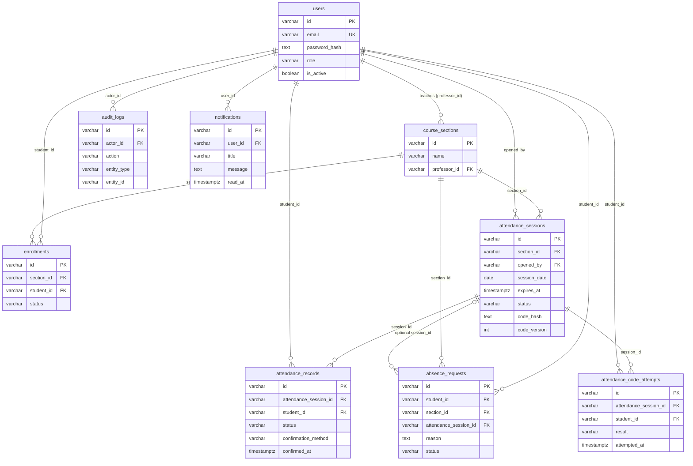

# Presenter guide: how the attendance system works

This guide describes the system as it is implemented in `app/`. Where the
planning documents in `docs/` describe something that is not built yet, this is
called out explicitly. Present the implemented behavior, and use the "Known gaps"
section if someone asks about security or missing features.

## 1. Language and framework

- **Language:** Python 3.11+ (Docker image uses Python 3.12).
- **Web framework:** FastAPI, served by Uvicorn.
- **ORM:** SQLAlchemy 2.0.
- **Configuration:** pydantic-settings, read from environment variables or `.env`.
- **Not used:** Node/Express, Spring Boot, Django, ASP.NET.

Source files:

| File | Purpose |
| --- | --- |
| `app/main.py` | All routes and business rules |
| `app/models.py` | Database tables (SQLAlchemy models) |
| `app/schemas.py` | Request and response validation (Pydantic) |
| `app/security.py` | Passwords, codes, JWT, role checks |
| `app/db.py` | Database connection and schema setup |
| `app/config.py` | Settings and secrets |

## 2. Database

- **Production / Docker:** PostgreSQL 16 (`docker-compose.yml`), via the
  `psycopg` driver.
- **Local fallback:** SQLite (`sqlite:///./attendance.db`) if `DATABASE_URL` is
  not set.
- **Schema setup:** tables are created automatically at startup
  (`Base.metadata.create_all`). There is no migration tool such as Alembic.
  `ensure_additive_schema()` adds three location columns to existing databases.

## 3. Attendance code generation

The code is created in `make_code()` (`app/security.py`):

1. Each of the **10 characters** is picked with `secrets.choice`, a
   cryptographically secure source.
2. The alphabet has 29 symbols: letters and digits without look-alikes
   (no `0/O`, `1/I/L`, `5/S`), so a code read off a projector is not mistyped.
   The randomness is about **48 bits**.
3. Students can type it in lowercase, with spaces, or with a dash. The server
   normalizes the input (`normalize_code()`) before comparing.

Codes are generated once per attendance session, when the professor opens it
(`POST /api/v1/attendance-sessions`). One code is shared by all students in that
session. It is not single-use per student.

**Validity:**

- Lifetime is set by `duration_minutes`: default **15**, allowed range **1–120**.
- The code stops working when `expires_at` passes (the API returns `410`), or when
  the professor cancels the session (`status = cancelled`).
- The professor can rotate the code with `POST /api/v1/attendance-sessions/{id}/rotate-code`.
  This increments `code_version`, so the old code and any QR tokens issued earlier stop working.

**Storage:** the plain code is returned once in the response to the professor.
The database stores only `code_hash`, which is an **HMAC-SHA256** of the code
keyed with `CODE_SECRET`.

**Case sensitivity:** the comparison is exact. A student who types lowercase
letters is rejected. The student UI should uppercase the input before sending it.

## 4. Stopping code sharing

| Control | Status | Detail |
| --- | --- | --- |
| Time window | Implemented | Expires after `duration_minutes`, checked on the server |
| One confirmation per student per session | Implemented | `UNIQUE(attendance_session_id, student_id)` on records. A second attempt returns `409` |
| Enrollment check | Implemented | Student must have an `active` enrollment in the section, or the API returns `403` |
| Signed QR token | Implemented | JWT (HS256, `CODE_SECRET`) with `session_id`, `code_version`, and `exp` |
| Optional location fence | Implemented, per session | Professor can set latitude, longitude, and radius (10–1000 m). The server computes the distance (haversine) and rejects students outside it (`403`) |
| Attempt logging | Implemented | Every accepted, invalid, or not-enrolled attempt is written to `attendance_code_attempts` |
| Rate limiting | Implemented | Failed attempts (`invalid`, `not_enrolled`) are counted per student, per client IP, and per device within a sliding window (default 10 min). Going over a limit returns `429` and logs a `rate_limited` attempt. Limits: 5 per student, 30 per IP, 30 per device |
| IP and device check | Implemented | Each attempt stores the client IP and an optional `X-Device-Id` header. One device can confirm for only one student per session (`409` otherwise) |
| One-time QR token | Implemented | Each QR token carries a random nonce and expires after 30 s (`QR_TTL_SECONDS`). The nonce is saved on the attendance record with a unique index, so a token works for one student only. The professor refreshes the QR with `POST .../qr-token` |
| Code rotation | Implemented | `POST .../rotate-code` issues a new code and increments `code_version`. The old code and any QR tokens issued before the rotation stop working |

**What to say:** the window is short, each student can count only once, and
enrollment is required. A QR code now works for one student and expires within
30 seconds, so a screenshot is useless once it has been used or has expired. Failed
guesses are rate-limited, and one device cannot confirm for two students. Codes
can be rotated during a session. The optional location fence is still the main
defence against someone sharing the code with students who are not in the room,
and only if the professor turns it on.

**Limits of these controls:** the IP is the address the app sees directly. Behind a
reverse proxy, every student would share the proxy's address, so the IP limit
needs proxy headers configured before production. The device ID is a header the
client sends, so a determined student can change it. These controls deter casual
sharing and guessing. They do not stop a student who is willing to work around them.

**Location caveat:** the distance check uses coordinates sent by the student's
device. GPS can be spoofed, so the fence is a deterrent, not proof of presence.

## 5. Two-factor authentication

**Not implemented.** Login is email and password only. There is no email code,
authenticator app, or SMS. Notifications are in-app only (`GET /api/v1/notifications`).

## 6. Password storage

Passwords are hashed with `pwdlib`, using `PasswordHash.recommended()`. In
pwdlib this is Argon2 (Argon2id). It is **not bcrypt**. Passwords must be at
least **12 characters** (`UserCreate` in `app/schemas.py`).

> Note: `pwdlib` was not installed in the environment where this guide was
> written, so the algorithm name was not checked by running code. Confirm it with
> `PasswordHash.recommended().hashers` after `pip install .`.

## 7. Login method

- **Token type:** JWT (HS256), sent as `Authorization: Bearer <token>`. The API
  is stateless; no server-side sessions are stored.
- **Claims:** `sub` (user ID), `role`, `exp`. Lifetime is `ACCESS_TOKEN_MINUTES`,
  default **30**.
- **Per request:** the user is loaded from the database and rejected if
  `is_active` is false. This is why a deactivated account stops working
  immediately, even with a valid token.
- **Login endpoints:** `POST /api/v1/auth/token` returns the JWT for API
  clients. `POST /api/v1/auth/login` (used by the web UI) puts it in an
  HTTP-only, `SameSite=Strict` cookie instead, and `POST /api/v1/auth/logout`
  clears it. Both take form fields `username` (email) and `password`.
- **Brute-force protection:** after **10** failed sign-ins for one email within
  **15** minutes, further attempts get `429` (`login_attempts` table).
- **Professor accounts:** registering as a professor requires the
  `PROFESSOR_SIGNUP_CODE` the department hands out. Students register freely.
- **Not implemented:** refresh tokens and server-side token revocation.

## 8. Main API endpoints

All paths start with `/api/v1` unless noted. "Role" is the caller's role that the
endpoint enforces.

| Method | Path | Role | Purpose |
| --- | --- | --- | --- |
| GET | `/health` | none | Health check |
| POST | `/auth/register` | none | Create a student, or a professor with the access code |
| POST | `/auth/token` | none | Log in, returns JWT |
| POST | `/auth/login`, `/auth/logout` | none | Browser sign-in / sign-out with an HTTP-only cookie |
| GET | `/users/me` | any logged-in user | Current user |
| GET | `/sections` | any logged-in user | Professor: classes taught. Student: classes enrolled in. Each with its open session |
| POST | `/sections` | professor | Create a class section |
| POST | `/sections/{section_id}/enrollments` | professor | Enroll a student (`email` or `student_id` in body) |
| DELETE | `/sections/{section_id}/enrollments/{student_id}` | professor | Remove a student; their history is kept |
| GET | `/sections/{section_id}/students` | professor | Students in the class |
| GET | `/sections/{section_id}/sessions` | professor | Sessions with status and counts |
| GET | `/attendance-sessions/{session_id}/records` | professor | Who is in class (present or late), newest first |
| GET | `/attendance-sessions/{session_id}/roster` | professor | Every student the session counts for, with status |
| PUT | `/attendance-sessions/{session_id}/students/{student_id}` | professor | Set a student to `present`, `late`, `excused`, or `absent` by hand |
| POST | `/attendance-sessions/{session_id}/close` | professor | End attendance early; still counts in statistics |
| POST | `/attendance-sessions` | professor | Open attendance. Returns `code`, `qr_token`, `expires_at` |
| POST | `/attendance-sessions/{session_id}/confirm` | student | Submit `code` or `qr_token` (plus location if required) |
| POST | `/attendance-sessions/{session_id}/qr-token` | professor | Issue a fresh single-use QR token (valid 30 s). Call repeatedly to refresh the QR on screen |
| POST | `/attendance-sessions/{session_id}/rotate-code` | professor | Replace the session code. Returns the new code and a QR token. Old codes and QR tokens stop working |
| POST | `/attendance-sessions/{session_id}/cancel` | professor | Cancel an open session. Notifies enrolled students |
| POST | `/absence-requests` | student | Submit an excused-absence request |
| GET | `/absence-requests/me` | student | Own requests |
| POST / GET | `/absence-requests/{request_id}/attachment` | student / owner or professor | Upload (PDF, PNG, JPEG, max 5 MB) or open the evidence file |
| GET | `/sections/{section_id}/absence-requests` | professor | List requests for a section |
| PATCH | `/absence-requests/{request_id}` | professor | Approve or reject. Approving a request for a class excuses the student from it |
| GET | `/notifications` | any logged-in user | Latest 100 notifications |
| POST | `/notifications/read` | any logged-in user | Mark all notifications read |
| GET | `/students/me/statistics` | student | Own attendance percentage and per-session status |
| GET | `/sections/{section_id}/statistics` | professor | Class totals and per-session confirmation counts |

Interactive docs are at `/docs` (Swagger UI) and `/redoc`.

**"Get attendance":** professors use `/attendance-sessions/{id}/roster` for the
full list with statuses. Students get their own per-session status from
`/students/me/statistics`.

## 9. Database tables

Ten tables are implemented in `app/models.py`. All primary keys are UUIDs stored
as `VARCHAR(36)`.

**users**

| Field | Type | Notes |
| --- | --- | --- |
| id | varchar(36) | PK |
| email | varchar(320) | Unique, indexed. Stored lowercase |
| password_hash | text | Argon2 hash |
| first_name | varchar(100) | |
| last_name | varchar(100) | |
| role | varchar(20) | Indexed. `professor` or `student` |
| is_active | boolean | Default true |

**course_sections** (the "subject" / class)

| Field | Type | Notes |
| --- | --- | --- |
| id | varchar(36) | PK |
| name | varchar(200) | For example "Databases, group A" |
| professor_id | varchar(36) | FK → users.id, indexed |

**enrollments** (student in a section)

| Field | Type | Notes |
| --- | --- | --- |
| id | varchar(36) | PK |
| section_id | varchar(36) | FK → course_sections.id, indexed |
| student_id | varchar(36) | FK → users.id, indexed |
| status | varchar(20) | `active`, or `removed` after the professor removes the student |
| enrolled_at | timestamptz | Sessions that started earlier don't count for the student |
| ended_at | timestamptz | Set on removal; later sessions don't count |
|  |  | `UNIQUE(section_id, student_id)` |

**attendance_sessions** (one class meeting with a code)

| Field | Type | Notes |
| --- | --- | --- |
| id | varchar(36) | PK |
| section_id | varchar(36) | FK → course_sections.id, indexed |
| opened_by | varchar(36) | FK → users.id (the professor) |
| session_date | date | |
| starts_at | timestamptz | |
| expires_at | timestamptz | |
| status | varchar(20) | `open`, `closed`, or `cancelled` |
| code_hash | text | HMAC of the code. The plain code is never stored |
| code_version | integer | Default 1. Incremented by `rotate-code`, which invalidates older QR tokens |
| location_latitude | float | Optional |
| location_longitude | float | Optional |
| allowed_radius_meters | integer | Optional, 10–1000 |
| late_after_minutes | integer | Optional. Confirmations after this many minutes are `late` |

**attendance_records** (successful confirmations)

| Field | Type | Notes |
| --- | --- | --- |
| id | varchar(36) | PK |
| attendance_session_id | varchar(36) | FK → attendance_sessions.id, indexed |
| student_id | varchar(36) | FK → users.id, indexed |
| status | varchar(20) | `present`, `late` (after `late_after_minutes`), or `excused` |
| confirmation_method | varchar(20) | `code`, `qr`, `manual` (set by the professor), or `absence_request` |
| confirmed_at | timestamptz | |
| latitude | float | Optional, as sent by the student |
| longitude | float | Optional, as sent by the student |
|  |  | `UNIQUE(attendance_session_id, student_id)` |

**attendance_code_attempts** (audit of every submission)

| Field | Type | Notes |
| --- | --- | --- |
| id | varchar(36) | PK |
| attendance_session_id | varchar(36) | FK → attendance_sessions.id, indexed |
| student_id | varchar(36) | FK → users.id, indexed |
| result | varchar(30) | `accepted`, `invalid`, or `not_enrolled` |
| attempted_at | timestamptz | |

**audit_logs** (who did what)

| Field | Type | Notes |
| --- | --- | --- |
| id | varchar(36) | PK |
| actor_id | varchar(36) | FK → users.id, indexed |
| action | varchar(100) | For example `attendance_confirmed`, `attendance_cancelled`, `absence_approved` |
| entity_type | varchar(100) | For example `attendance_session` |
| entity_id | varchar(36) | Not a foreign key, so it can point to any table |
| created_at | timestamptz | |

**absence_requests**

| Field | Type | Notes |
| --- | --- | --- |
| id | varchar(36) | PK |
| student_id | varchar(36) | FK → users.id, indexed |
| section_id | varchar(36) | FK → course_sections.id, indexed |
| attendance_session_id | varchar(36) | FK → attendance_sessions.id, optional |
| reason | text | 10–2000 characters |
| attachment_url | text | Optional, must be `http(s)`. The UI uses uploads instead |
| attachment_path | varchar(64) | Random file name in `UPLOAD_DIR` for an uploaded file |
| attachment_name | varchar(255) | Original file name, shown to the user |
| attachment_type | varchar(50) | Detected from the file's bytes, not its name |
| status | varchar(20) | Default `pending`. Then `approved` or `rejected` |
| created_at | timestamptz | |

**login_attempts** (sign-in rate limiting)

| Field | Type | Notes |
| --- | --- | --- |
| id | varchar(36) | PK |
| email | varchar(320) | Indexed, lowercase |
| succeeded | boolean | |
| attempted_at | timestamptz | |

**notifications**

| Field | Type | Notes |
| --- | --- | --- |
| id | varchar(36) | PK |
| user_id | varchar(36) | FK → users.id, indexed |
| title | varchar(200) | |
| message | text | |
| read_at | timestamptz | Set by `POST /notifications/read` |
| created_at | timestamptz | |

## 10. How the tables link

Key constraints:

- `enrollments`: one row per student per section.
- `attendance_records`: one row per student per session (no double confirmation).

## 11. Roles and relationships

- **Roles** are stored as a text field, `users.role`, with the values `professor`
  and `student`. There is no separate roles table. The value is checked when a
  user registers, and each endpoint checks it with `require_role(...)`.
- **There is no admin role** in the code, although some planning docs mention one.
- **Teacher to subject:** a professor is linked to a section through
  `course_sections.professor_id`. A section is the "subject" in this design. It
  has a name but no separate course table. One professor per section.
- **Student to group:** students are linked to sections through `enrollments`.
  This is many-to-many: a student can be in several sections, and a section has
  many students. There is no separate "group" concept. A section is the group.

## 12. Known gaps (say these before someone finds them)

These are real limitations in the current code. Presenting them openly is better
than being asked about them.

1. **Professor sign-up uses a shared access code,** not institutional SSO or
   administrator approval. Anyone who learns the code can register as a
   professor, so change it whenever it leaks.
2. **Rate limits and device checks depend on the deployment.** Behind a reverse
   proxy, set Uvicorn's `FORWARDED_ALLOW_IPS` to the proxy's address, or every
   student shares one IP limit. The device ID is client-supplied.
3. **Location relies on client-reported GPS,** which can be spoofed. Treat it as
   a deterrent, not proof.
4. **No 2FA, refresh tokens, or token revocation.**
5. **No migrations.** Schema changes depend on `create_all` and the
   `ensure_additive_schema()` helper, which only adds columns.
6. **Uploads are stored on local disk** (`UPLOAD_DIR`) without virus scanning
   or a retention policy.
7. **An absence request for a class that hasn't happened yet** cannot excuse it
   automatically. The professor sets the student to Excused in that session's
   attendance list afterwards.
8. **Planned design is not built.** `docs/attendance-database.md` and
   `docs/attendance-database.puml` also describe `departments`, `courses`,
   `student_profiles`, `professor_profiles`, and `class_meetings`. None of these
   exist in `app/models.py`. Present the tables in section 9 as the real schema.
