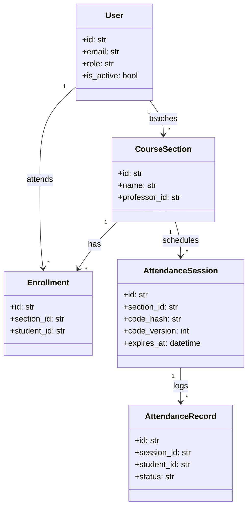

# System Remediation and Implementation Plan

**Target System:** `teamwork-attendance` (FastAPI / SQLAlchemy 2.0 / PostgreSQL / SQLite)  
**Document Purpose:** Actionable technical plan detailing identified bugs, missing endpoints, architectural discrepancies, and concrete implementation fixes to be shared with the development team.

---

## 1. Executive Summary

A comprehensive audit of the `teamwork-attendance` codebase against the project specification, documentation (`docs/`), and test suite revealed that while core security controls (cryptographic codes, single-use QR tokens with nonces, rate limiting, and geofencing) are implemented, the system cannot currently support an end-to-end user workflow.

Key findings:
1. **Critical Usability Blockers:** Missing read/discovery endpoints prevent students from discovering session IDs to enter codes, and prevent professors from listing their sections, viewing class rosters, or seeing who attended a session.
2. **Logic Bugs & Flaws:** Cancelled sessions penalize students as unexcused absences in statistics (currently flagged as a strict `xfail` test); approved absence requests do not excuse absences; and typed codes are strictly case-sensitive, creating false failed attempts.
3. **Infrastructure & Integration Gaps:** Absence of CORS middleware blocks frontend integration; reverse-proxy IP handling causes shared rate-limit lockouts; and database migrations lack tooling (Alembic).

---

## 2. Issue Catalog and Supposed Fixes

---

### Category A: Core Logic Bugs & Behavioral Repairs

#### A.1 Cancelled and Active Sessions Counted as Unexcused Absences
- **Severity:** High
- **Affected File:** [`app/main.py`](file:///D:/lab_web/teamwork-attendance/app/main.py#L530-L612)
- **Current Behavior:** [`student_statistics`](file:///D:/lab_web/teamwork-attendance/app/main.py#L530) fetches all sessions for a section without checking their `status`. Sessions that were cancelled by the professor, as well as ongoing sessions that haven't ended yet, count towards `total_sessions` and are labeled `"absent"` if no record exists. This causes [`tests/test_absence_and_stats.py:test_cancelled_session_is_not_counted_as_absence`](file:///D:/lab_web/teamwork-attendance/tests/test_absence_and_stats.py#L120) to fail (currently marked `xfail`).
- **Supposed Fix:**
  1. Filter out `SessionStatus.CANCELLED` from both student statistics and section statistics.
  2. For student statistics, either exclude sessions whose `expires_at` is still in the future or mark their status as `"pending"` / `"in_progress"` rather than `"absent"`.
  3. Remove the `@pytest.mark.xfail` decorator in `tests/test_absence_and_stats.py`.
```python
# In app/main.py: student_statistics
sessions = db.scalars(
    select(AttendanceSession)
    .join(Enrollment, Enrollment.section_id == AttendanceSession.section_id)
    .where(
        Enrollment.student_id == student.id,
        Enrollment.status == "active",
        AttendanceSession.status != SessionStatus.CANCELLED,
    )
    .order_by(AttendanceSession.session_date)
).all()
```

---

#### A.2 Approved Absence Requests Do Not Excuse Attendance
- **Severity:** High
- **Affected Files:** [`app/models.py`](file:///D:/lab_web/teamwork-attendance/app/models.py#L31-L35), [`app/main.py`](file:///D:/lab_web/teamwork-attendance/app/main.py#L493-L566)
- **Current Behavior:** When a professor approves an absence request (`PATCH /api/v1/absence-requests/{request_id}`), `absence.status` changes to `"approved"`, but no change occurs in the student's attendance records. In `student_statistics`, the student is still marked `"absent"`.
- **Supposed Fix:**
  1. Add `EXCUSED = "excused"` to `AttendanceStatus` in `app/models.py`.
  2. In `review_absence`, when status is approved and `absence.attendance_session_id` is present, insert an `AttendanceRecord` with `status="excused"` (or adjust `student_statistics` to count approved absences as excused/attended).
  3. Add `excused: int` to `StudentStatsResponse` in `app/schemas.py`.

---

#### A.3 Strict Case Sensitivity Rejects Valid Student Code Entries
- **Severity:** Medium
- **Affected File:** [`app/main.py`](file:///D:/lab_web/teamwork-attendance/app/main.py#L347)
- **Current Behavior:** [`make_code`](file:///D:/lab_web/teamwork-attendance/app/security.py#L28-L30) produces an uppercase string (e.g. `ABC123XYZ0`). If a student on a phone types `abc123xyz0`, the raw HMAC mismatch causes an `invalid` attempt which increments the lockout counter.
- **Supposed Fix:**
  Normalize the student input before hashing/matching:
```python
# In app/main.py: confirm_attendance
raw_code = payload.code.strip().upper() if payload.code else None
code_ok = bool(raw_code and code_matches(raw_code, session.code_hash))
```

---

#### A.4 `AttendanceStatus.LATE` Is Never Assigned
- **Severity:** Low
- **Affected File:** [`app/main.py`](file:///D:/lab_web/teamwork-attendance/app/main.py#L377-L410)
- **Current Behavior:** `AttendanceStatus.LATE` exists in models, schema, and statistics, but [`confirm_attendance`](file:///D:/lab_web/teamwork-attendance/app/main.py#L316) always writes `status="present"`.
- **Supposed Fix:**
  1. Introduce an optional grace period configuration (e.g., `late_threshold_minutes: int = 5`).
  2. If `now_utc() > session.starts_at + timedelta(minutes=settings.late_threshold_minutes)`, assign `status = AttendanceStatus.LATE`.
  3. Allow professors to manually update attendance records to `"late"`.

---

#### A.5 Client IP Behind Reverse Proxies Triggers Global Lockout
- **Severity:** High
- **Affected Files:** [`app/main.py`](file:///D:/lab_web/teamwork-attendance/app/main.py#L79-L81), [`app/config.py`](file:///D:/lab_web/teamwork-attendance/app/config.py)
- **Current Behavior:** `client_ip(request)` retrieves `request.client.host`. In a Dockerized or cloud deployment (behind Nginx, Caddy, or an AWS Load Balancer), every request originates from the proxy's IP. The IP rate limit (`attempt_limit_per_ip: 30`) locks out all students campus-wide once 30 failed attempts accumulate.
- **Supposed Fix:**
  1. Add `uvicorn` proxy header forwarding or FastAPI middleware to extract the real client IP from `X-Forwarded-For` when running behind trusted proxies.
  2. Make trusted proxy CIDRs configurable in `Settings`.

---

### Category B: Missing APIs & Core Functional Gaps

#### B.1 Student Class and Session Discovery Endpoints
- **Severity:** Critical (Blocks student mobile/web usage)
- **Missing Endpoints:**
  - `GET /api/v1/students/me/sections` (List enrolled classes)
  - `GET /api/v1/students/me/active-sessions` (List open attendance sessions for enrolled classes)
  - `GET /api/v1/students/me/absence-requests` (List historical absence requests submitted by student)
- **Supposed Fix:**
  Implement endpoints in `app/main.py` allowing authenticated students to view their classes, detect if an attendance session is currently open in one of their classes, retrieve the `session_id`, and submit a typed code without having to scan a QR code.

---

#### B.2 Professor Class Management & Attendee List Endpoints
- **Severity:** Critical (Blocks professor workflow)
- **Missing Endpoints:**
  - `GET /api/v1/sections` (List professor's own sections)
  - `GET /api/v1/sections/{id}/enrollments` (List enrolled students in a section)
  - `GET /api/v1/users?role=student&query={email|name}` (Search students to enroll them by UUID)
  - `GET /api/v1/attendance-sessions/{session_id}/records` (View list of students who attended, confirmation method, timestamp, and coordinates)
  - `POST /api/v1/attendance-sessions/{session_id}/close` (Close session without cancelling and without sending false cancellation notices)
  - `POST /api/v1/attendance-sessions/{session_id}/records/manual` (Manual override to mark a student present/excused)
- **Supposed Fix:**
  Implement these endpoints with role-based checks ensuring only the owner professor can view section rosters, attendees, or modify session records.

---

#### B.3 User Profile and Notification State Endpoints
- **Severity:** Medium
- **Missing Endpoints:**
  - `GET /api/v1/users/me`: Return current user profile, role, and details.
  - `PATCH /api/v1/notifications/{id}/read` or `POST /api/v1/notifications/mark-read`: Update `read_at` on notifications.
- **Supposed Fix:**
  Add a current user endpoint and notification read handler to allow client frontends to render user headers and badge counters.

---

#### B.4 Document Upload Service for Absence Proof
- **Severity:** Medium
- **Affected File:** [`app/main.py`](file:///D:/lab_web/teamwork-attendance/app/main.py#L441)
- **Current Behavior:** `AbsenceRequestCreate` accepts an arbitrary `attachment_url` string.
- **Supposed Fix:**
  Provide an upload endpoint `POST /api/v1/uploads` accepting `multipart/form-data` (PDF, PNG, JPEG), validate file mime-type and magic bytes, store files in a secure storage path or S3/MinIO bucket, and generate a pre-signed URL or local reference ID.

---

### Category C: Frontend, Infrastructure, and Security

#### C.1 Missing CORS Middleware
- **Severity:** Critical for Frontend
- **Affected File:** [`app/main.py`](file:///D:/lab_web/teamwork-attendance/app/main.py#L62-L68)
- **Current Behavior:** `FastAPI` instance has no CORS middleware configured. Any separate web client (e.g. React/Vite running on `http://localhost:5173`) will be rejected by browser SOP (Same-Origin Policy).
- **Supposed Fix:**
```python
from fastapi.middleware.cors import CORSMiddleware

app.add_middleware(
    CORSMiddleware,
    allow_origins=["http://localhost:3000", "http://localhost:5173"],
    allow_credentials=True,
    allow_methods=["*"],
    allow_headers=["*"],
)
```

---

#### C.2 Deprecated Lifespan Event Handlers
- **Severity:** Low (Code Health)
- **Affected File:** [`app/main.py`](file:///D:/lab_web/teamwork-attendance/app/main.py#L150)
- **Current Behavior:** Uses `@app.on_event("startup")`, which produces deprecation warnings in current FastAPI/Starlette versions.
- **Supposed Fix:**
  Refactor database table creation and additive schema check into an `asynccontextmanager` lifespan:
```python
from contextlib import asynccontextmanager

@asynccontextmanager
async def lifespan(app: FastAPI):
    Base.metadata.create_all(bind=engine)
    ensure_additive_schema()
    yield

app = FastAPI(title="Attendance API", lifespan=lifespan)
```

---

#### C.3 Insecure Key Length Warnings (RFC 7518)
- **Severity:** Medium
- **Affected Files:** [`app/config.py`](file:///D:/lab_web/teamwork-attendance/app/config.py#L8-L9), [`tests/conftest.py`](file:///D:/lab_web/teamwork-attendance/tests/conftest.py#L8-L9)
- **Current Behavior:** Default test and fallback secrets (e.g. `"test-jwt-secret"`) are under 32 bytes (256 bits), emitting 200+ warnings during test execution.
- **Supposed Fix:**
  Use 32+ character secrets (e.g., `secrets.token_hex(32)`) in default settings, example envs, and test configurations.

---

#### C.4 Database Migration Tooling (Alembic)
- **Severity:** High (Production Readiness)
- **Affected File:** [`app/db.py`](file:///D:/lab_web/teamwork-attendance/app/db.py#L27-L57)
- **Current Behavior:** Relies on `ensure_additive_schema()` with manual `ALTER TABLE` statements. Does not handle column drops, index renames, or type alterations.
- **Supposed Fix:**
  Initialize Alembic (`alembic init alembic`), configure `env.py` to point to `app.db.Base.metadata`, and generate versioned migration scripts.

---

#### C.5 Open Self-Registration Vulnerability
- **Severity:** High
- **Affected File:** [`app/main.py`](file:///D:/lab_web/teamwork-attendance/app/main.py#L161-L176)
- **Current Behavior:** Anyone calling `POST /api/v1/auth/register` with `role="professor"` can create an active professor account and manage sections.
- **Supposed Fix:**
  1. Enforce university email domain validation (e.g., `@university.edu` or separate professor domains).
  2. Require new professor accounts to have `is_active=False` until confirmed via email token or approved by an administrator.

---

### Category D: Architectural Alignment with Documentation

The initial design in `docs/attendance-database.md` and `docs/attendance-database.puml` specified entities that were omitted in `app/models.py`.



**Missing Target Architecture Entities to Implement:**
1. **`admin` Role:** Implement system administrator role for approving professor accounts and auditing.
2. **`courses` & `departments`:** Decouple `course_sections` from standalone subjects by adding `departments` (e.g. CS, EE) and `courses` (e.g. CS101), with `course_sections` specifying term, year, and section code.
3. **`student_profiles` & `professor_profiles`:** Store student numbers, year levels, department associations, and employee numbers.
4. **`class_meetings`:** Store regular recurring class schedules (day of week, start time, room) to automate session generation.

---

## 3. Implementation Phases and Roadmap

```mermaid
flowchart TD
    subgraph Phase 1: Critical Bug Fixes & Discovery APIs
        A1[Fix Statistics Query for Cancelled Sessions] --> A2[Remove xfail in Tests]
        A3[Upper-case Code Normalization] --> A4[Add Student & Professor Discovery Endpoints]
        A4 --> A5[Add Attendee List Endpoint]
    end

    subgraph Phase 2: Integration & Infrastructure
        B1[Add CORS Middleware] --> B2[Migrate Startup to FastAPI Lifespan]
        B3[Setup Real IP Handling for Proxy] --> B4[Configure Alembic Migrations]
        B5[Update Default Key Lengths to 32+ bytes]
    end

    subgraph Phase 3: Absence Enhancements & Frontend
        C1[Connect Absence Approval to Attendance Status] --> C2[File Upload Endpoint for Proofs]
        C3[Implement Web / Mobile UI Client]
    end

    Phase 1 --> Phase 2 --> Phase 3
```

### Detailed Roadmap

| Phase | Milestone | Priority | Effort |
|---|---|:---:|:---:|
| **Phase 1** | **Bug Fixes & Usability APIs**<br>• Exclude cancelled sessions from stats ([`app/main.py`](file:///D:/lab_web/teamwork-attendance/app/main.py))<br>• Code case-insensitivity<br>• Implement `GET /sections`, `GET /students/me/sections`<br>• Implement `GET /attendance-sessions/{id}/records`<br>• Normal session close endpoint (`/close`) | **P0** | 1-2 days |
| **Phase 2** | **Infrastructure & Integration**<br>• Add `CORSMiddleware`<br>• Lifespan handler refactor<br>• Fix proxy IP retrieval<br>• Initialize Alembic migrations<br>• Increase secret key lengths in `.env.example` and test suite | **P1** | 1-2 days |
| **Phase 3** | **Business Logic & Security Hardening**<br>• Excused attendance status on absence approval<br>• File uploads for absence requests<br>• Notification mark-read endpoint<br>• Email verification / domain restriction on registration | **P2** | 2-3 days |
| **Phase 4** | **Frontend UI & Full Architecture**<br>• Build Student portal (My Classes, Active Attendance QR/Code scanner, Stats, Absences)<br>• Build Professor portal (Section Management, Attendance Launcher with QR generator, Live Attendees, Absence Review)<br>• Academic entities (`departments`, `courses`, `profiles`) | **P3** | 1-2 weeks |
